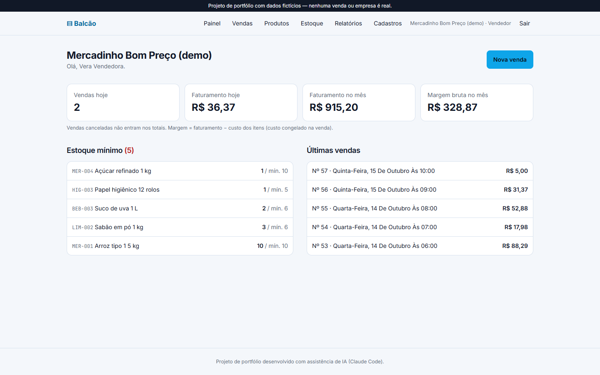
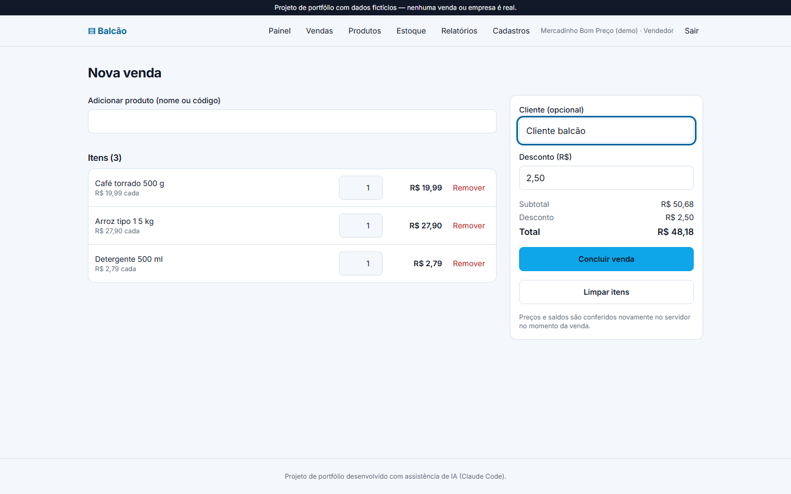
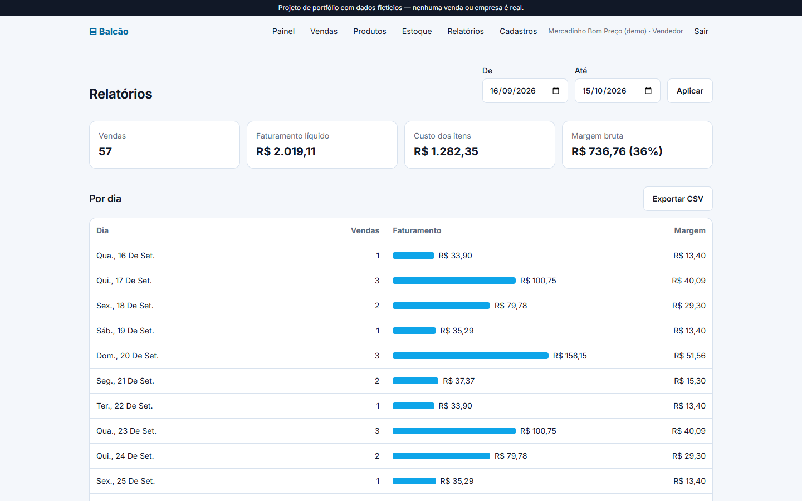

# Balcão — mini-ERP de estoque e vendas

> Projeto de portfólio com **dados fictícios**, desenvolvido com assistência de IA (Claude Code).
> Não há empresas, clientes ou vendas reais.

**Demonstração:** [balcao-mini-erp.vercel.app](https://balcao-mini-erp.vercel.app) (contas de demonstração em configuração) · **CI:** ver aba Actions

<!-- Screenshots reais serão adicionadas após o deploy (docs/screenshots/). -->

## Telas

<table>
  <tr>
    <td width="33%"><a href="docs/telas/painel.png"></a><br><sub>Painel: vendas do dia, margem e alertas de estoque mínimo</sub></td>
    <td width="33%"><a href="docs/telas/nova-venda.png"></a><br><sub>Nova venda com busca, desconto e total em centavos</sub></td>
    <td width="33%"><a href="docs/telas/relatorios.png"></a><br><sub>Relatórios por dia e por produto</sub></td>
  </tr>
</table>

<sub>Capturas com os dados fictícios da demonstração.</sub>

## O problema

Pequenos comércios controlam estoque em planilhas: o saldo diverge da prateleira, vendas são
lançadas sem baixar o estoque, ninguém sabe quando repor e não há histórico de quem mexeu em quê.

**Público:** donos e equipes de pequenos comércios (mercearia, conveniência, papelaria).

## Funcionalidades

- **Vendas** com vários itens, desconto e número sequencial; baixa automática do estoque.
- **Cancelamento** de venda (só administrador) com devolução ao estoque por estorno.
- **Estoque:** entradas (com custo), saídas (com motivo) e ajustes por contagem física.
- **Histórico** imutável de movimentações, com saldo resultante de cada uma.
- **Alertas** de estoque mínimo no painel.
- **Relatórios** por período (por dia e por produto): faturamento, custo, margem; exportação CSV.
- **Cadastros** de produtos, categorias e fornecedores, com busca, filtros e paginação.
- **Perfis** por organização: administrador, vendedor, estoquista e somente leitura.

### Como experimentar

- **Criar conta:** você vira administrador de uma empresa fictícia **só sua**, com 12 produtos e
  30 dias de vendas de exemplo.
- **Contas compartilhadas** (empresa “Mercadinho Bom Preço (demo)”, redefinida diariamente; senha `demo12345`):
  `vendedor@erp.demo.test`, `estoquista@erp.demo.test`, `leitura@erp.demo.test`.
  Nenhuma conta pública tem papel de administrador.

## Decisões técnicas

### 1. Venda e estoque na mesma transação
`erp.create_sale` (PL/pgSQL) faz tudo numa transação:

1. **bloqueia** as linhas dos produtos com `SELECT … FOR UPDATE` **em ordem de id**;
2. **valida o saldo de todos os itens** — se um faltar, nada é gravado e a mensagem diz qual
   (“Café 500 g (disponível: 1, pedido: 2)”);
3. grava venda, itens (com preço e custo **congelados**), baixa o estoque e registra uma
   movimentação por item com o saldo resultante.

**Por que ordenar os bloqueios?** Duas vendas com os mesmos produtos em ordens diferentes (A+B e
B+A) poderiam se travar mutuamente (deadlock). Com uma ordem global, a segunda sempre espera a
primeira. O script `pnpm test:concorrencia` verifica isso contra o Supabase real.

### 2. Saldo nunca negativo
Três camadas: validação com a linha bloqueada (concorrência), `check (stock >= 0)` (última
barreira) e **ausência de permissão** para editar `stock` diretamente — só as funções de
movimentação e venda alteram o saldo. Um teste garante que o saldo de cada produto é sempre a soma
das suas movimentações.

### 3. Dinheiro sem arredondamento
Valores em **centavos inteiros** (`bigint`) do banco à interface. O formulário converte “12,90”
para 1290 sem passar por `float` (`parseMoneyToCents`), totais são somas de inteiros e o CSV
formata centavos com aritmética inteira. O navegador **não envia preços**: o servidor usa o preço
atual do produto.

### 4. Isolamento por organização
- RLS em todas as tabelas (`erp.is_member(org_id)`), papéis checados nas funções.
- **Chaves estrangeiras compostas** `(org_id, id)` impedem, no próprio banco, ligar um produto a
  uma categoria ou venda de outra organização.
- Testes cobrem leitura cruzada de 7 tabelas, escrita em organização alheia e cancelamento de venda alheia.

### 5. Histórico imutável e remoção segura
Vendas e movimentações não têm políticas de escrita. As FKs de itens e movimentações para produtos
são `DEFERRABLE INITIALLY DEFERRED`: apagar uma **organização inteira** (redefinição da demo)
funciona, mas apagar **um produto com histórico** é recusado — produtos são desativados, não apagados.

### 6. Infraestrutura compartilhada
Schema `erp` no mesmo projeto Supabase das outras demos (o plano gratuito permite 2 projetos). Um
cadastro feito em outro app do portfólio não ganha organização aqui (teste automatizado).

## Design

Identidade visual baseada no sistema `dashboard` do [open-design](https://github.com/nexu-io/open-design)
(licença Apache-2.0): superfícies claras e frias, azul-céu nas ações, foco em leitura de números. Os tokens foram adaptados em `src/app/globals.css`, com
tons de texto ajustados para contraste AA (WCAG 4,5:1) e a cor da marca separada em preenchimento
(botões) e texto (links e foco). Cada app do portfólio usa um sistema diferente.

## Arquitetura

```
Navegador ──► Next.js 16 (Server Components + Server Actions, Zod) ──► Supabase Postgres (schema erp)
                 │ proxy.ts renova a sessão                              ├─ RLS por organização
                 │ /relatorios/csv (Route Handler)                       ├─ funções transacionais (vendas, estoque)
                 └─ Sentry (erros, sem dados pessoais)                   └─ relatórios em SQL (fuso da organização)
```

**Tecnologias:** Next.js 16 · React 19 · TypeScript · Tailwind CSS 4 · Supabase (Postgres, Auth,
RLS) · Zod · Sentry · Vitest · PGlite · GitHub Actions · Vercel.

## Como executar

Requisitos: Node 20.9+ (recomendado 24), pnpm, um projeto Supabase.

```bash
pnpm install
cp .env.example .env.local   # preencha com as chaves do seu projeto
```

1. No Supabase, **Project Settings → API → Exposed schemas**: adicione `erp`.
2. Aplique `supabase/migrations/` (SQL Editor ou `supabase db push`).
3. `pnpm seed:demo` cria a empresa demo e as contas compartilhadas.
4. `pnpm dev` → http://localhost:3000

## Testes

```bash
pnpm test              # regras de negócio + banco (PGlite, sem Docker)
pnpm test:concorrencia # vendas simultâneas e cruzadas contra um Supabase real
pnpm lint && pnpm typecheck && pnpm build
```

Os testes de banco aplicam a migração real num PGlite com um stub mínimo do Supabase e cobrem:
venda atômica, saldo insuficiente sem gravação parcial, desconto em centavos, papéis, entradas,
saídas, ajustes, imutabilidade, estorno, relatórios, alertas, isolamento entre organizações e
remoção em cascata. O teste de concorrência roda no Supabase real porque o PGlite tem uma conexão.

## Limitações

- Receita por produto é **bruta** (antes do desconto, que é aplicado ao total da venda); o relatório
  diário usa o total líquido. A tela explica a diferença.
- Custo do produto é o **último custo de entrada** (não custo médio ponderado).
- Sem nota fiscal, multidepósito, convites de equipe pela interface ou pagamentos.
- O projeto Supabase gratuito pausa após 7 dias sem uso.

## Melhorias futuras

Custo médio ponderado · convites por e-mail · leitor de código de barras · curva ABC · testes E2E
com Playwright no CI.

## Guia de estudo

[docs/guia-de-estudo.md](docs/guia-de-estudo.md) — como explicar as decisões em entrevistas.

## Transparência sobre o uso de IA

Código, testes e documentação produzidos com assistência do Claude Code (Anthropic), sob minha
direção e revisão. As decisões estão registradas aqui e no histórico de commits.
